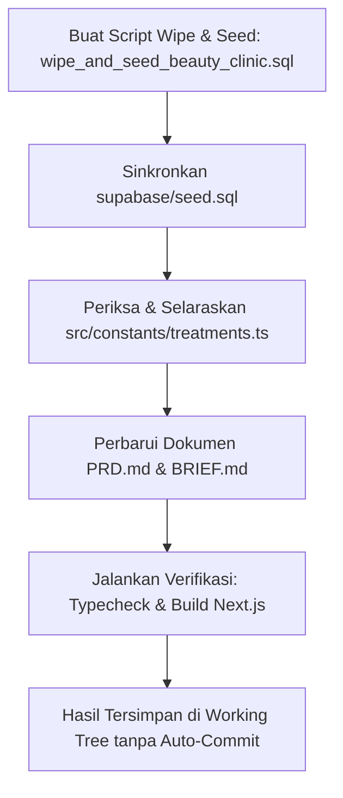

# Plan: Revisi Domain Klinik Kecantikan, Database Wipe & Seed, dan Pembaruan Dokumen

**Tanggal**: 4 November 2026  
**Konteks**: Penyesuaian data domain klinik kecantikan (Aesthetic & Dermatology Clinic), penyediaan script wipe & re-seed database Supabase, dan pembaruan dokumen terkait (`PRD.md`, `BRIEF.md`).  
**Status**: Draf Rencana (Awaiting Execution)

---

## 1. Latar Belakang & Masalah
- **Inkonsistensi Data**: Antarmuka pengguna (landing page, hero banner, treatment tabs) telah memposisikan platform sebagai klinik kecantikan (*"Klinik Kecantikan Terbaik di Indonesia"* dengan layanan Acne Dermapeel, IPL Acne, Skin Booster, dsb.). Namun, data master pada database (`supabase/seed.sql`) dan tampilan panel dokter masih memuat spesialisasi rumah sakit umum (*Spesialis Anak, Penyakit Dalam, Kandungan, Dokter Gigi*).
- **Kebutuhan Pengujian**: Diperlukan skrip terstandarisasi untuk membersihkan (*wipe*) seluruh transaksi dan data relasional, lalu men-seed ulang data master dan jadwal klinik kecantikan secara bersih dan otomatis.
- **Kebutuhan Dokumentasi**: Dokumen PRD dan BRIEF perlu diperbarui agar seluruh pihak memiliki pemahaman yang selaras mengenai domain klinik kecantikan.

---

## 2. Rincian Spesifikasi & Rencana Perubahan

### A. Spesialisasi Klinik Kecantikan (`public.specialists`)
Mengganti seluruh spesialisasi umum dengan 5 bidang keahlian estetika medis:
1. **Dermatologi, Venereologi & Estetika (Sp.D.V.E / Sp.KK)**
   - *Fokus*: Jerawat inflamasi kronis, melasma, hiperpigmentasi, eksim, dermatitis, dan perbaikan skin barrier.
2. **Dokter Estetika Medik & Anti-Aging (Aesthetic Medicine & AAAM)**
   - *Fokus*: Prosedur peremajaan non-invasif: botox, dermal filler, thread lift (tarik benang), mesoterapi, dan collagen stimulator.
3. **Spesialis Bedah Plastik Rekonstruksi & Estetik (Sp.B.P.R.E)**
   - *Fokus*: Blefaroplasti, revisi scar bopeng mendalam, keloid treatment, dan rekonstruksi kontur wajah estetika.
4. **Laser & Kosmetika Kulit (Cosmetic Dermatology & Advanced Energy)**
   - *Fokus*: Pico Laser, Fractional CO2 Laser, Q-Switched Nd:YAG, Intense Pulsed Light (IPL), dan Radiofrequency (RF).
5. **Trikologi & Perawatan Kulit Kepala (Hair & Scalp Specialist)**
   - *Fokus*: Terapi kerontokan rambut (alopesia), Platelet-Rich Plasma (PRP) scalp therapy, dan stimulasi folikel rambut.

---

### B. Profil Dokter Estetika (`public.doctors`)
Mengonfigurasi 6 dokter kecantikan dengan bio profesional dan tarif realistis:
1. **dr. Maya Lestari, Sp.D.V.E, FINSDV**
   - *Spesialisasi*: Dermatologi, Venereologi & Estetika
   - *Pengalaman*: 11 Tahun | *Biaya Konsultasi*: Rp 250.000
   - *Bio*: Lulusan Spesialis Kulit UI dengan sertifikasi internasional laser dermatologi. Ahli dalam menangani acne vulgaris kronis dan melasma membandel.
2. **dr. Gisella Valerie, Dipl. AAAM**
   - *Spesialisasi*: Dokter Estetika Medik & Anti-Aging
   - *Pengalaman*: 8 Tahun | *Biaya Konsultasi*: Rp 180.000
   - *Bio*: Bersertifikasi American Academy of Aesthetic Medicine. Ahli dalam facial contouring, baby botox, lip filler, dan collagen stimulator.
3. **dr. Kevin Prasetya, Sp.B.P.R.E**
   - *Spesialisasi*: Bedah Plastik Rekonstruksi & Estetik
   - *Pengalaman*: 14 Tahun | *Biaya Konsultasi*: Rp 350.000
   - *Bio*: Spesialis bedah plastik estetik dengan fokus pada blepharoplasty, revisi scar mendalam, dan kontur wajah alami.
4. **dr. Natasha Wijaya, M.Biomed (AAM)**
   - *Spesialisasi*: Laser & Kosmetika Kulit
   - *Pengalaman*: 9 Tahun | *Biaya Konsultasi*: Rp 200.000
   - *Bio*: Magister Anti-Aging Medicine, fokus pada teknologi Pico Laser, Yellow Laser untuk vaskular/kemerahan, dan RF Microneedling.
5. **dr. Amanda Clarissa, Sp.D.V.E**
   - *Spesialisasi*: Dermatologi, Venereologi & Estetika
   - *Pengalaman*: 7 Tahun | *Biaya Konsultasi*: Rp 220.000
   - *Bio*: Berpengalaman dalam perbaikan skin barrier rusak, penanganan jerawat remaja/dewasa, dan skin booster Salmon DNA Polynucleotide.
6. **dr. Reza Mahendra, Dipl. CIBTAC, AAAM**
   - *Spesialisasi*: Trikologi & Perawatan Kulit Kepala
   - *Pengalaman*: 6 Tahun | *Biaya Konsultasi*: Rp 175.000
   - *Bio*: Memiliki keahlian khusus dalam penanganan kerontokan rambut androgenetik, PRP Hair Regrowth, dan body slimming non-bedah.

---

### C. Jadwal Praktik Dokter & Sesi Antrean (`public.doctor_schedules` & `practice_sessions`)
- Menyusun jadwal operasional klinik yang aktif setiap hari (Senin–Minggu):
  - **Sesi Pagi**: 09:00 – 12:00 WIB (Kuota: 8–10 pasien)
  - **Sesi Siang**: 13:00 – 17:00 WIB (Kuota: 10–12 pasien)
  - **Sesi Sore/Malam**: 17:00 – 21:00 WIB (Kuota: 8 pasien)
- Menjamin setiap hari selalu terdapat sesi dokter yang aktif untuk pengujian alur booking pasien dan scan antrean resepsionis.

---

### D. Skrip Pembersih & Seed Ulang Database (`supabase/wipe_and_seed_beauty_clinic.sql`)
1. **TRUNCATE Tabel Atomik**:
   ```sql
   TRUNCATE TABLE 
     public.ratings,
     public.payment_proofs,
     public.appointments,
     public.practice_sessions,
     public.doctor_schedules,
     public.doctors,
     public.specialists
   CASCADE;
   ```
2. **Pertahankan Akun Demo**:
   - Admin: `admin@klinik.test` / `Admin123!`
   - Pasien: `pasien@klinik.test` / `Pasien123!`
3. **Data Uji Coba Terhubung**:
   - Janji temu status `done` dengan QR Token aktif (`99999999-0000-0000-0000-000000000003`) untuk pengujian scan barcode check-in.
   - Janji temu status `waiting_confirmation` untuk pengujian verifikasi bukti bayar admin.
4. **Runner Script**:
   - Disediakan file SQL yang dapat dieksekusi langsung di Supabase SQL Editor atau via script terminal.

---

### E. Pembaruan Dokumen Terkait
1. **`PRD.md`**:
   - Memperbarui identitas sistem menjadi *Beauty & Aesthetic Clinic Appointment Platform*.
   - Menyelaraskan seluruh istilah layanan, spesialisasi, dan prosedur klinik kecantikan.
2. **`BRIEF.md`**:
   - Memperbarui skenario spesialisasi dokter dan alur reservasi klinik kecantikan.

---

## 3. Tahapan Eksekusi



1. **Langkah 1**: Buat skrip SQL lengkap `supabase/wipe_and_seed_beauty_clinic.sql` dan update `supabase/seed.sql`.
2. **Langkah 2**: Periksa konsistensi harga, kategori, dan slug di `src/constants/treatments.ts`.
3. **Langkah 3**: Perbarui `PRD.md` dan `BRIEF.md`.
4. **Langkah 4**: Verifikasi dengan `npx tsc --noEmit` dan `npm run build`.
5. **Langkah 5**: Laporkan ringkasan ke pengguna tanpa menjalankan `git commit` otomatis.

