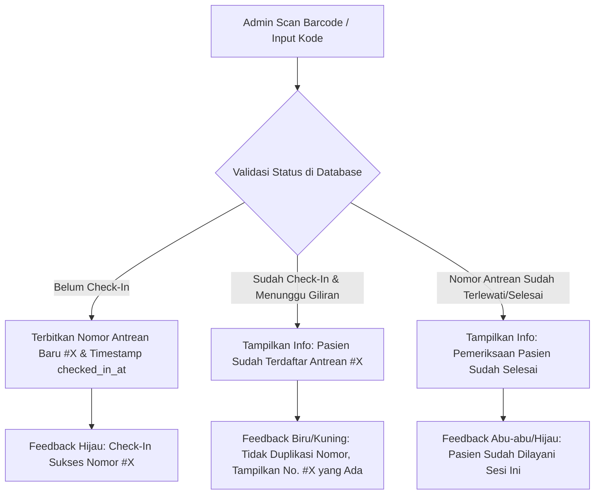

# [002] Plan: Audit Flow Antrean, Pencegahan Duplikasi Scan, dan Penyempurnaan Visual Antrean Pasien

**Tanggal**: 4 November 2026  
**Konteks**: Audit menyeluruh alur antrean admin (scan barcode, pemrosesan nomor antrean, pencegahan duplikasi scan & penanganan pasien selesai) serta alur antrean pasien (visualisasi nomor antrean akurat, status kedatangan, dan riwayat yang transparan).  
**Status**: Selesai Diterapkan & Diverifikasi (Completed)

---

## 1. Hasil Audit Alur Antrean Saat Ini (Current State Analysis)

### Sisi Admin:
1. **Pencegahan Duplikasi di Backend**:
   - Di fungsi database `check_in(p_qr_token)`, pengecekan `checked_in_at is not null` saat ini melempar PostgreSQL Exception: `raise exception 'Pasien sudah check-in dengan nomor antrean %'`.
   - **Kelemahan UX**: Di frontend admin (`queue-management.tsx` dan `admin-floating-scanner.tsx`), exception ini tertangkap sebagai `checkInError` (warna merah / pesan galat), sehingga membingungkan staf resepsionis seolah-olah terjadi kegagalan teknis.
2. **Ketiadaan Status "Pasien Selesai"**:
   - Jika pasien yang nomor antreannya sudah lewat/selesai di-scan kembali, sistem belum membedakan apakah pasien tersebut masih mengantre atau konsultasinya sudah rampung.

### Sisi Pasien:
1. **Ambiguitas Nomor Antrean Sebelum vs Sesudah Check-In**:
   - Pada kartu riwayat dan komponen `appointment-qr.tsx`, `queue_number` fisik kedatangan belum dibedakan secara visual dari `booking_number`.
   - Pasien yang belum tiba di klinik belum mendapatkan petunjuk visual bahwa nomor urut fisik baru akan terbit setelah QR di-scan di resepsionis klinik.
2. **Ketiadaan Pemantauan Posisi Antrean Pribadi**:
   - Pasien yang sudah check-in belum melihat posisi nomor antreannya relatif terhadap nomor yang sedang dilayani dokter (*"Sedang Dilayani"*, *"Menunggu 2 Pasien Lagi"*, atau *"Selesai"*).

---

## 2. Rencana Peningkatan Sistem & Arsitektur

---

## 3. Rincian Rencana Perubahan (Action Items)

### A. Peningkatan RPC Database `check_in_patient` (Idempotent & Anti-Duplikasi)
Membuat atau memperbarui fungsi RPC `public.check_in_v2(p_token text)` yang ramah dan aman:
1. Menerima input fleksibel: UUID token QR, format gabungan `KODE:TOKEN`, maupun kode janji temu `APT-XXX`.
2. Jika pasien **belum check-in**:
   - Mengunci sesi (`FOR UPDATE`).
   - Menerbitkan `queue_number = COALESCE(MAX(queue_number), 0) + 1`.
   - Mencatat `checked_in_at = NOW()`.
   - Mengembalikan payload:
     `{ success: true, already_checked_in: false, is_completed: false, queue_number: X, checked_in_at: ... }`.
3. Jika pasien **sudah pernah check-in sebelumnya**:
   - **TIDAK melempar exception fatal**, melainkan mengembalikan data status yang jelas:
     - Jika `v_session.current_queue_number >= v_appt.queue_number`:
       `{ success: true, already_checked_in: true, is_completed: true, queue_number: X, message: 'Pemeriksaan pasien ini sudah selesai dilayani.' }`.
     - Jika `v_session.current_queue_number < v_appt.queue_number`:
       `{ success: true, already_checked_in: true, is_completed: false, queue_number: X, message: 'Pasien sudah check-in sebelumnya dengan nomor antrean #' || X }`.

---

### B. Penyempurnaan UI Pemindai Admin (`queue-management.tsx` & `admin-floating-scanner.tsx`)
1. **Kartu Feedback Multi-Status**:
   - **Sukses Baru (Hijau)**: *"Check-In Berhasil! Nomor Antrean Diterbitkan: #X"*.
   - **Sudah Terdaftar (Biru/Amber)**: *"Pasien Sudah Check-In Sebelumnya: Nomor Antrean #X"* (mencegah kepanikan resepsionis dan menghindari duplikasi tiket).
   - **Selesai Diperiksa (Netral/Hijau Gelap)**: *"Konsultasi Pasien Ini Telah Selesai Dilayani"*.
2. **Audio Feedback Berbeda**:
   - Beep nada tinggi untuk check-in baru sukses.
   - Beep lembut informatif untuk verifikasi pasien yang sudah terdaftar.

---

### C. Penyempurnaan Tampilan Antrean Sisi Pasien (`appointment-qr.tsx` & `appointment-card.tsx`)
1. **Kondisi Sebelum Check-In (Belum Tiba di Klinik)**:
   - Tampilkan QR Code berukuran besar dan tajam.
   - Tampilkan badge status jelas: `Belum Check-In di Klinik`.
   - Instruksi panduan: *"Tunjukkan QR Code ini kepada petugas resepsionis begitu tiba di klinik untuk menerbitkan Nomor Antrean Pemeriksaan Anda."*
2. **Kondisi Setelah Check-In (Sudah Tiba & Terdaftar Antrean)**:
   - Tampilkan **Nomor Antrean Anda: #X** dengan tipografi besar dan jelas.
   - Waktu check-in: *"Tercatat hadir pukul HH:mm WIB"*.
   - **Live Tracker Sederhana**:
     - Menampilkan nomor antrean dokter yang sedang berlangsung (misal: `#2`).
     - Indikator: *"Giliran Anda Sedang Berlangsung!"* (jika nomor sama) atau *"Menunggu X antrean lagi"*.
   - Tautan langsung ke layar display publik TV (`/queue`).
3. **Penyempurnaan Halaman Riwayat (`/history`)**:
   - Menampilkan status check-in, nomor antrean resmi, jam check-in, dan nama dokter spesialis kecantikan secara kronologis dan transparan.

---

## 4. Rencana File yang Dimodifikasi

1. **`supabase/migrations/20261104000300_safe_checkin_anti_duplication.sql`**:
   - SQL function `check_in_v2` / peningkatan `check_in` pencegah duplikasi.
2. **`src/hooks/api/use-admin-appointments.ts`**:
   - Integrasi response aman check-in.
3. **`src/components/admin/queue/queue-management.tsx`**:
   - Tampilan kartu status check-in multi-state (Baru, Sudah Ada, Selesai).
4. **`src/components/admin/queue/admin-floating-scanner.tsx`**:
   - Tampilan responsif hasil scan anti-duplikasi.
5. **`src/components/user/booking/appointment-qr.tsx`**:
   - Visualisasi nomor antrean dinamis (Sebelum vs Sesudah Check-In).
6. **`src/components/user/history/appointment-card.tsx`**:
   - Informasi detail riwayat kedatangan & nomor antrean.

---

## 6. Hasil Eksekusi & Status Verifikasi

1. **RPC Database `check_in(p_qr_token text)`**:
   - Berhasil dibuat di `supabase/migrations/20261104000300_safe_checkin_anti_duplication.sql`.
   - Idempoten: Tidak melempar error merah saat di-scan ulang, mengembalikan data status `already_checked_in: true` dan nomor antrean yang sama tanpa menduplikasi nomor antrean.
   - Deteksi otomatis pasien selesai jika `v_session.current_queue_number >= v_appt.queue_number`.
2. **Scanner & Manajemen Antrean Admin**:
   - `src/components/admin/queue/queue-management.tsx` dan `src/components/admin/queue/admin-floating-scanner.tsx` telah diselaraskan.
   - Kartu feedback multi-state: Hijau (Baru terbit), Amber (Sudah terdaftar & nomor tidak diduplikasi), Ungu (Pemeriksaan telah selesai).
3. **Visualisasi Antrean Pasien**:
   - `src/components/user/booking/appointment-qr.tsx`: Menampilkan panduan barcode besar sebelum check-in vs nomor antrean `#X` besar dengan status "Terverifikasi Hadir" sesudah check-in.
   - `src/components/user/history/appointment-card.tsx`: Menampilkan badge "Aktif" vs "Belum Scan" serta modal barcode yang membedakan status kedatangan secara akurat.
4. **Verifikasi Build**:
   - `npx tsc --noEmit`: Lolos tanpa error (0 error).
   - `npm run build`: 56 route terkompilasi 100% sukses (Exit code: 0).
   - Seluruh perubahan berada di working tree tanpa `git commit` otomatis.

