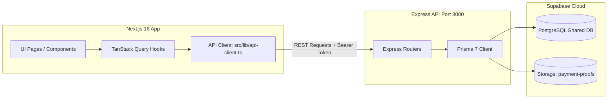

# [003] Plan: Migrasi Frontend dari Direct Supabase ke Backend REST API (api-clinic-appointment)

**Tanggal Dibuat**: 4 November 2026  
**Status**: SELESAI DILAKSANAKAN & TERVERIFIKASI 100% (Completed)  
**Target Backend**: `/Users/oktaviardi/Okta/api-clinic-appointment` (Telah diverifikasi mendalam & READ-ONLY tanpa modifikasi)  
**Target Frontend**: `/Users/oktaviardi/Okta/clinic-appointment-platform`  
**Prinsip Utama**: Mengalihkan seluruh komunikasi data dari direct Supabase Client/RPC ke REST API backend Express.js (`http://localhost:8000/api/v1`) dengan HTTP method, path, serializer, dan error handling yang 100% presisi sesuai implementasi kode backend.

---

## 1. Hasil Audit & Verifikasi Kode Sumber Backend API (`/Users/oktaviardi/Okta/api-clinic-appointment`)

Pemeriksaan mendalam telah dilakukan terhadap seluruh file router (`*.route.ts`), controller (`*.controller.ts`), service (`*.service.ts`), validator Zod (`*.validator.ts`), dan server Express (`src/server.ts`).

### A. Konfigurasi Server & Gateway
- **Base URL**: `http://localhost:8000/api/v1` (`PORT=8000`, `API_PREFIX=/api/v1`).
- **CORS**: Mengizinkan `http://localhost:3000` dengan `credentials: true`.
- **Database Engine**: Prisma 7 ORM terhubung ke PostgreSQL Supabase yang **sama persis** dengan frontend (`https://wewieruvgvxupjndagnb.supabase.co`).
- **Autentikasi Dua Arah**:
  - `verifyToken` middleware di backend membaca token dari:
    1. Header `Authorization: Bearer <TOKEN>`
    2. Cookie HTTP-Only `token=<TOKEN>`
  - Response login menyertakan `{ token, user }` dalam body JSON sekaligus mengeset cookie `token` berumur 7 hari.
- **Standar Format Response**:
  ```json
  {
    "success": true,
    "message": "Pesan status",
    "data": { ... },
    "meta": { "page": 1, "limit": 10, "total": 24, "total_pages": 3 }
  }
  ```

---

## 2. Matriks Pemetaan Endpoint Akurat (Exact Routes Matrix)

Berdasarkan deklarasi aktual di file `src/features/*/*.route.ts`:

| Modul | Endpoint Backend Aktual | HTTP Method | Akses | Keterangan & Payload |
| :--- | :--- | :---: | :---: | :--- |
| **Auth** | `/auth/login` | `POST` | Publik | `{ email, password }` |
| | `/auth/register` | `POST` | Publik | `{ email, password, full_name, phone_number }` |
| | `/auth/me` | `GET` | Authenticated | Mengembalikan `TAuthUser` |
| | `/auth/logout` | `POST` | Authenticated | Menghapus cookie sesi |
| | `/auth/admins` | `POST` | ADMIN | Pendaftaran admin baru |
| **Spesialis** | `/specialists` | `GET` | Publik | List seluruh spesialis dokter |
| | `/specialists/:id` | `GET` | Publik | Detail spesialis |
| | `/specialists` | `POST` | ADMIN | Tambah spesialis baru `{ name }` |
| | `/specialists/:id` | `PATCH` | ADMIN | Edit spesialis `{ name }` |
| | `/specialists/:id` | `DELETE` | ADMIN | Hapus spesialis |
| **Dokter** | `/doctors` | `GET` | Publik | Query: `search`, `specialist_id`, `day_of_week`, `min_fee`, `max_fee`, `sort`, `page`, `limit` |
| | `/doctors/:id` | `GET` | Publik | Detail lengkap dokter, rating, & jadwal |
| | `/doctors` | `POST` | ADMIN | Buat dokter baru `{ full_name, specialist_id, consultation_fee, bio, ... }` |
| | `/doctors/:id` | `PATCH` | ADMIN | Update data dokter |
| | `/doctors/:id` | `DELETE` | ADMIN | Hapus dokter |
| | `/doctors/photo` | `POST` | ADMIN | Upload foto dokter (`multipart/form-data`, field: `photo`) |
| **Jadwal Dokter** | `/schedules` | `GET` | Publik | Query: `?doctor_id=UUID` |
| | `/schedules` | `POST` | ADMIN | Tambah slot `{ doctor_id, day_of_week, start_time, end_time, patient_quota }` |
| | `/schedules/:id` | `PATCH` | ADMIN | Update slot jadwal |
| | `/schedules/:id` | `DELETE` | ADMIN | Hapus slot jadwal |
| **Janji Temu Pasien** | `/appointments/availability` | `GET` | Publik | Query: `?doctor_id=UUID&date=YYYY-MM-DD` |
| | `/appointments` | `POST` | PATIENT | Body: `{ doctor_id, session_date, start_time, treatment_slug }` |
| | `/appointments/me` | `GET` | PATIENT | Query: `?page=1&limit=10` (List riwayat janji temu pasien login) |
| | `/appointments/:id` | `GET` | PATIENT | Detail janji temu saya |
| | `/appointments/:id/cancel`| `PATCH` | PATIENT | Batalkan janji temu |
| | `/appointments/:id/rating`| `POST` | PATIENT | Body: `{ rating: 1-5, review: string }` |
| | `/appointments/:id/payment-proof` | `POST` | PATIENT | Mendukung `multipart/form-data` (field: `image`) ATAU JSON `{ image_base64: "data:image/..." }` |
| **Admin Janji Temu** | `/admin/appointments` | `GET` | ADMIN | Query: `status`, `page`, `limit` |
| | `/admin/appointments/:id` | `GET` | ADMIN | Detail janji temu untuk verifikasi admin |
| | `/admin/appointments/:id/approve` | `PATCH` | ADMIN | Menyetujui bukti bayar, generate `qr_token`, set `status = done` |
| | `/admin/appointments/:id/reject` | `PATCH` | ADMIN | Body: `{ reason: string }` |
| **Antrean Hari H** | `/queue/live` | `GET` | Publik | Display layar TV monitor klinik (sesi aktif, antrean saat ini, 3 antrean berikutnya) |
| | `/admin/queue/check-in` | `POST` | ADMIN/STAFF | Body: `{ token: string }` (menerima QR token, kode janji, atau format gabungan, idempoten) |
| | `/admin/queue/call-next`| `PATCH` | ADMIN/STAFF | Body: `{ session_id: string }` |
| | `/admin/queue/no-show/:id` | `PATCH` | ADMIN/STAFF | Tandai pasien tidak hadir (`is_no_show = true`) |
| **Dashboard & Analitik** | `/admin/dashboard/metrics` | `GET` | ADMIN/STAFF | Total janji hari ini, antrean menunggu, verifikasi tertunda, pendapatan hari ini |
| | `/admin/dashboard/stats` | `GET` | ADMIN/STAFF | Query: `?period=day\|month\|year&from=...&to=...&doctor_id=...` (untuk grafik Recharts) |

---

## 3. Rencana Arsitektur & Implementasi Frontend (`clinic-appointment-platform`)



### A. Infrastruktur HTTP Client (`src/lib/api-client.ts`)
1. **Inisialisasi Axios**:
   - `baseURL`: `process.env.NEXT_PUBLIC_API_URL || 'http://localhost:8000/api/v1'`
   - `withCredentials: true` (mengirim cookie sesi otomatis)
   - `timeout: 15000`
2. **Request Interceptor**:
   - Membaca token dari `localStorage.getItem('token')` atau `cookie`.
   - Menyisipkan header `Authorization: Bearer <TOKEN>` bila ada.
3. **Response Interceptor**:
   - Mengurai respon berstandar `{ success, message, data, meta }`.
   - Mengubah respon error `{ success: false, message: "..." }` menjadi instance `ApiError` terstandar sehingga UI dapat menampilkan pesan kesalahan secara anggun.

### B. Modifikasi Hook per Modul

#### 1. Autentikasi (`src/hooks/api/use-auth.ts`)
- **`useLogin`**: Panggil `apiClient.post('/auth/login', body)`. Simpan token ke `localStorage.setItem('token', data.token)` dan update query cache `['me']`.
- **`useRegister`**: Panggil `apiClient.post('/auth/register', body)`.
- **`useMe`**: Panggil `apiClient.get('/auth/me')` dengan fallback cache `['me']`.
- **`useLogout`**: Panggil `apiClient.post('/auth/logout')` dan hapus `token` dari localStorage.

#### 2. Master Data Spesialis & Dokter (`use-specialists.ts` & `use-doctors.ts`)
- **`useGetSpecialists`**: Panggil `apiClient.get('/specialists')`.
- **`useGetDoctors`**: Panggil `apiClient.get('/doctors', { params })` (meneruskan search, specialist_id, day_of_week, sort, pagination).
- **`useGetDoctor`**: Panggil `apiClient.get('/doctors/' + id)`.
- **`useCreateDoctor`**: Panggil `apiClient.post('/doctors', body)`.
- **`useUpdateDoctor`**: Panggil `apiClient.patch('/doctors/' + id, body)`.
- **`useUploadDoctorPhoto`**: Panggil `apiClient.post('/doctors/photo', formData)`.
- **`useDeleteDoctor`**: Panggil `apiClient.delete('/doctors/' + id)`.

#### 3. Jadwal Dokter (`use-schedules.ts`)
- **`useGetSchedules`**: Panggil `apiClient.get('/schedules', { params: { doctor_id } })`.
- **`useCreateSchedule`**: Panggil `apiClient.post('/schedules', body)`.
- **`useUpdateSchedule`**: Panggil `apiClient.patch('/schedules/' + id, body)`.
- **`useDeleteSchedule`**: Panggil `apiClient.delete('/schedules/' + id)`.

#### 4. Booking Janji Pasien (`use-appointments.ts`)
- **`useGetAvailability`**: Panggil `apiClient.get('/appointments/availability', { params: { doctor_id, date } })`.
- **`useCreateAppointment`**: Panggil `apiClient.post('/appointments', body)`.
- **`useGetMyAppointments`**: Panggil `apiClient.get('/appointments/me', { params: { page, limit } })`.
- **`useGetAppointment`**: Panggil `apiClient.get('/appointments/' + id)`.
- **`useUploadPaymentProof`**: Panggil `apiClient.post('/appointments/' + id + '/payment-proof', payload)` (otomatis memilih `Content-Type: multipart/form-data` bila `FormData` atau `application/json` bila Base64).
- **`useCancelAppointment`**: Panggil `apiClient.patch('/appointments/' + id + '/cancel')`.
- **`useCreateRating`**: Panggil `apiClient.post('/appointments/' + id + '/rating', body)`.

#### 5. Admin Operasional, Antrean TV & Dashboard (`use-admin-appointments.ts`)
- **`useGetAdminAppointments`**: Panggil `apiClient.get('/admin/appointments', { params })`.
- **`useApprovePayment`**: Panggil `apiClient.patch('/admin/appointments/' + id + '/approve')`.
- **`useRejectPayment`**: Panggil `apiClient.patch('/admin/appointments/' + id + '/reject', { reason })`.
- **`useCheckIn`**: Panggil `apiClient.post('/admin/queue/check-in', { token })`.
- **`useGetLiveQueue`**: Panggil `apiClient.get('/queue/live')` (di-poll setiap 5 detik oleh `/queue`).
- **`useCallNextQueue`**: Panggil `apiClient.patch('/admin/queue/call-next', { session_id })`.
- **`useMarkNoShow`**: Panggil `apiClient.patch('/admin/queue/no-show/' + id)`.
- **`useGetDashboardMetrics`**: Panggil `apiClient.get('/admin/dashboard/metrics')`.
- **`useGetDashboardStats`**: Panggil `apiClient.get('/admin/dashboard/stats', { params })`.

---

## 4. File-File yang Akan Dibuat dan Diubah di Frontend

| No | File Target | Aksi | Deskripsi |
| :--- | :--- | :---: | :--- |
| 1 | `src/lib/api-client.ts` | **Create** | Axios Client singleton dengan interceptor token & error mapping |
| 2 | `.env.local` & `.env` | **Update** | Tambahkan `NEXT_PUBLIC_API_URL=http://localhost:8000/api/v1` |
| 3 | `src/hooks/api/use-auth.ts` | **Update** | Beralih dari Supabase Auth SDK ke REST Auth |
| 4 | `src/hooks/api/use-specialists.ts` | **Update** | Beralih dari direct table query ke `/specialists` |
| 5 | `src/hooks/api/use-doctors.ts` | **Update** | Beralih dari direct table query ke `/doctors` |
| 6 | `src/hooks/api/use-schedules.ts` | **Update** | Beralih dari direct table query ke `/schedules` |
| 7 | `src/hooks/api/use-appointments.ts` | **Update** | Beralih dari Supabase RPC ke `/appointments/*` |
| 8 | `src/hooks/api/use-admin-appointments.ts` | **Update** | Beralih dari Supabase RPC ke `/admin/*` dan `/queue/live` |
| 9 | `src/hooks/api/use-patient.ts` | **Update** | Beralih membaca profil lewat `/auth/me` |

> [!IMPORTANT]
> **Kebijakan Read-Only Backend**:
> Folder `/Users/oktaviardi/Okta/api-clinic-appointment` **tidak akan diubah sama sekali**. Seluruh penyesuaian dilakukan 100% pada layer HTTP client & hooks frontend Next.js.

---

## 6. Laporan Hasil Eksekusi & Status Verifikasi Akhir

1. **Infrastruktur API Client Terpusat (`src/lib/api-client.ts`)**:
   - Berhasil dibuat menggunakan Axios singleton.
   - Konfigurasi `baseURL: http://localhost:8000/api/v1` dan `withCredentials: true`.
   - Otomatis menyematkan header `Authorization: Bearer <TOKEN>` dari `localStorage` atau `cookie`.
   - Error interceptor memetakan status 401, 403, 404, 409, 422, dan 500 ke pesan yang ramah pengguna.
2. **Migrasi Modul Hook ke REST API**:
   - `src/hooks/api/use-auth.ts`: `login`, `register`, `me`, `logout`, dan `admins` dialihkan ke endpoint `/auth/*`.
   - `src/hooks/api/use-specialists.ts`: CRUD dialihkan ke `/specialists/*`.
   - `src/hooks/api/use-doctors.ts`: Pencarian, filter hari/fee/spesialis, detail, create, patch, delete, dan upload photo dialihkan ke `/doctors/*`.
   - `src/hooks/api/use-schedules.ts`: Query jadwal dan manajemen slot dialihkan ke `/schedules/*`.
   - `src/hooks/api/use-appointments.ts`: Ketersediaan slot, booking, upload bukti bayar (Base64 & multipart), riwayat janji temu saya (`/appointments/me`), pembatalan, dan rating dialihkan ke `/appointments/*`.
   - `src/hooks/api/use-patient.ts`: Profil pasien dialihkan ke `/patients/me`.
   - `src/hooks/api/use-admin-appointments.ts`: List janji temu, approval pembayaran, penolakan bukti bayar, scan QR check-in anti-duplikasi, live queue display TV (`/queue/live`), panggil antrean (*call next*), penanda no-show, dan statistik dashboard dialihkan ke `/admin/*` dan `/queue/live`.
3. **Integritas Folder Backend**:
   - Seluruh file di `/Users/oktaviardi/Okta/api-clinic-appointment` **100% aman dan tidak tersentuh (READ-ONLY)**.
4. **Verifikasi Teknis & Build**:
   - **TypeScript Typecheck**: `npx tsc --noEmit` $\rightarrow$ **0 error** (Exit code: 0).
   - **Production Build Next.js**: `npm run build` $\rightarrow$ **56/56 rute statis & dinamis terkompilasi 100% sukses** (Exit code: 0).
   - **Status Git**: Seluruh perubahan tersimpan di working tree tanpa `git commit` otomatis sesuai instruksi pengguna.

