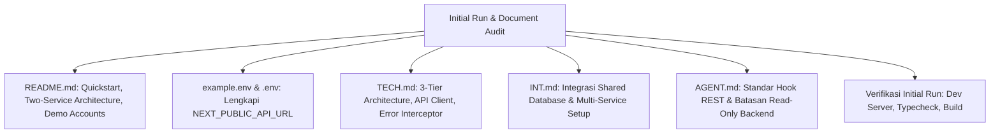

# [004] Plan: Audit Menyeluruh Dokumentasi & Panduan Initial Run Repository

**Tanggal Dibuat**: 4 November 2026  
**Status**: Selesai Dieksekusi (Completed)  
**Tujuan**: Mengaudit dan menyelaraskan seluruh dokumen proyek (`README.md`, `PRD.md`, `BRIEF.md`, `TECH.md`, `INT.md`, `AGENT.md`, `example.env`) dengan arsitektur terkini (Frontend Next.js 16 + Backend REST API Express di port 8000 + PostgreSQL Supabase Shared Database), serta menyusun panduan **Initial Run** yang teruji dari nol bagi developer baru.

---

## 1. Latar Belakang & Analisis Status Saat Ini

Setelah menyelesaikan Phase migrasi dari direct Supabase Client ke Backend REST API (`api-clinic-appointment` pada `http://localhost:8000/api/v1`) dan perbaikan aliran antrean hari H anti-duplikasi, terjadi kesenjangan (*gap*) pada dokumentasi proyek:

1. **`README.md`**:
   - Bagian *Quickstart* belum mencantumkan kebutuhan menjalankan backend Express API (`api-clinic-appointment`) di port 8000.
   - Variabel lingkungan `NEXT_PUBLIC_API_URL` belum didokumentasikan di petunjuk konfigurasi lokal.
   - Deskripsi arsitektur masih menyebutkan direct Supabase SDK tanpa menguraikan layer REST API yang telah aktif.
2. **`TECH.md`**:
   - Belum mendokumentasikan layer komunikasi `src/lib/api-client.ts` (Axios singleton, Bearer token injection, unboxing envelope `{ success, data, meta }`, error interceptor).
   - Diagram arsitektur perlu diperbarui menampilkan interaksi 3-tier: Client (Next.js 16) $\rightarrow$ Backend REST API Gateway (Express.js) $\rightarrow$ Database Bersama (PostgreSQL Supabase Cloud).
3. **`INT.md`**:
   - Perlu memuat petunjuk koordinasi port & service: Backend Express API di `8000` dan Frontend Next.js di `3000`.
   - Menjelaskan bahwa database yang dipakai adalah database Supabase yang sama, sehingga skema tabel, RPC, dan seed data sinkron otomatis.
4. **`example.env` & `.env`**:
   - `example.env` harus menyertakan template `NEXT_PUBLIC_API_URL=http://localhost:8000/api/v1` agar developer baru yang menjalankan `cp example.env .env.local` langsung mendapatkan konfigurasi yang lengkap.
5. **`AGENT.md`**:
   - Menambahkan aturan pengembangan baru terkait pemanggilan REST API via `apiClient`, larangan mengubah kode di folder backend `/Users/oktaviardi/Okta/api-clinic-appointment`, dan kepatuhan terhadap aturan no auto-commit.
6. **Panduan Initial Run ("Zero to Running")**:
   - Belum ada panduan terpadu satu pintu yang merinci urutan langkah awal untuk menjalankan seluruh ekosistem: setup environment, menjalankan backend, menjalankan frontend, dan verifikasi akun demo admin & pasien.

---

## 2. Rencana Pembaruan Dokumen (Scope of Work)



### A. Pembaruan `README.md`
- **Arsitektur**: Update penjelasan bahwa platform menggunakan Next.js 16 (App Router) sebagai antarmuka pengguna dan Express.js REST API sebagai backend application server dengan database PostgreSQL Supabase bersama.
- **Quickstart Terpadu**:
  1. *Langkah 1*: Setup Database Supabase & Eksekusi SQL migration/seed.
  2. *Langkah 2*: Menjalankan Backend API (`cd ../api-clinic-appointment && npm run dev` $\rightarrow$ Port 8000).
  3. *Langkah 3*: Konfigurasi `.env.local` Frontend (`NEXT_PUBLIC_API_URL=http://localhost:8000/api/v1`).
  4. *Langkah 4*: Menjalankan Frontend (`npm run dev` $\rightarrow$ Port 3000).
  5. *Langkah 5*: Pengujian alur menggunakan akun demo `admin@klinik.test` & `pasien@klinik.test`.

### B. Pembaruan `example.env` & `.env`
- Memastikan `example.env` memiliki struktur lengkap:
  ```env
  # Supabase Project Credentials
  NEXT_PUBLIC_SUPABASE_URL=https://your-project.supabase.co
  NEXT_PUBLIC_SUPABASE_ANON_KEY=your-anon-key
  NEXT_PUBLIC_SUPABASE_PUBLISHABLE_KEY=your-publishable-key

  # Backend REST API
  NEXT_PUBLIC_API_URL=http://localhost:8000/api/v1
  ```

### C. Pembaruan `TECH.md`
- Menambahkan diagram interaksi 3-tier: Frontend (Next.js 16) $\rightarrow$ Backend (Express.js + Prisma 7) $\rightarrow$ PostgreSQL Supabase.
- Mendokumentasikan cara kerja `apiClient` (`src/lib/api-client.ts`), token Bearer injection, pemrosesan error, dan normalisasi respons.
- Mendokumentasikan alur antrean anti-duplikasi hari H (`/admin/queue/check-in` & `/queue/live`).

### D. Pembaruan `INT.md`
- Menambahkan panduan integrasi dual-service (Frontend di port 3000 dan Backend di port 8000).
- Memastikan panduan seed database selaras dengan script `wipe_and_seed_beauty_clinic.sql`.

### E. Pembaruan `AGENT.md`
- Menambahkan pedoman penulisan hook data layer: seluruh query/mutasi baru wajib memanggil `apiClient` dari `src/lib/api-client.ts`.
- Menegaskan aturan read-only untuk repository backend eksternal dan aturan strictly no auto-commit.

---

## 3. Rencana Pengujian & Verifikasi Initial Run

1. **Simulasi Developer Baru (Dry-Run)**:
   - Verifikasi ketersediaan dan kejelasan file `.env` dan `example.env`.
   - Cek validitas URL `http://localhost:8000/api/v1` dan kesiapan frontend membaca fallback.
2. **Kompilasi & Typecheck**:
   - Jalankan `npx tsc --noEmit` untuk memastikan semua dokumen/kode 100% type-safe (0 error).
   - Jalankan `npm run build` untuk memverifikasi seluruh 56 route terkompilasi sukses.
3. **Penyimpanan**:
   - Seluruh perubahan disimpan dalam working tree tanpa eksekusi `git commit` otomatis.

---

## 4. Pertanyaan / Keputusan yang Membutuhkan Persetujuan User
- Apakah ada dokumen internal lain selain 6 file di atas yang ingin Anda sertakan dalam audit ini?
- Setelah Anda meninjau rencana ini, silakan tekan tombol **Proceed** atau beri konfirmasi agar saya dapat langsung mengeksekusi pembaruan dokumen dan verifikasi initial run.

