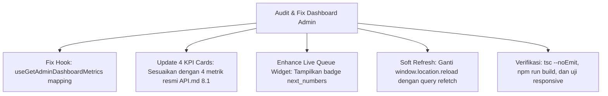

# [005] Plan: Penyelarasan API & Perbaikan Bug Halaman Dashboard Admin

**Tanggal Dibuat**: 5 November 2026  
**Status**: Selesai Dieksekusi (Completed 100%)  
**Tujuan**: Menyelaraskan seluruh komponen dan kartu metrik pada halaman **Dashboard Admin Operasional** (`/admin/dashboard`) dengan spesifikasi resmi dari `API.md` (Bagian 8.1 `/admin/dashboard/metrics`, Bagian 7.1 `/queue/live`, dan Bagian 9.1 `/admin/appointments`), serta memperbaiki bug pemetaan data KPI dan meningkatkan fungsionalitas UI.

---

## 1. Analisis Kesenjangan (Gap Analysis) Dashboard vs API.md

Setelah memeriksa implementasi pada `src/components/admin/dashboard/admin-dashboard.tsx` dan `src/hooks/api/use-admin-appointments.ts` terhadap dokumentasi resmi [**`API.md`**](/Users/oktaviardi/Okta/api-clinic-appointment/API.md), ditemukan 4 kesenjangan (*miss / bug*):

### Miss 1: Bug Pemetaan Nilai `doneCount` di Hook `useGetAdminDashboardMetrics`
- **Kode Saat Ini** (`src/hooks/api/use-admin-appointments.ts:344`):
  ```typescript
  doneCount: raw.today_appointments ?? raw.doneCount ?? 0,
  ```
- **Masalah**: Karena `raw.today_appointments` selalu bernilai angka (misal `0` atau `12`), ekspresi `raw.today_appointments ?? raw.doneCount` akan selalu mengambil `raw.today_appointments`. Akibatnya, nilai `doneCount` terduplikasi identik dengan `todayCount` bukannya membaca `raw.done_count` atau `raw.doneCount`.

---

### Miss 2: Kartu KPI ke-3 Tidak Menampilkan `waiting_queue` Sesuai `API.md` (Bagian 8.1)
- **Spesifikasi Resmi di `API.md` (Bagian 8.1)**:
  ```json
  {
    "today_appointments": 12,
    "waiting_queue": 3,
    "pending_verification": 1,
    "today_revenue": 4200000
  }
  ```
- **Kondisi UI Saat Ini**:
  - Kartu 1: "Janji Hari Ini" (`today_appointments`)
  - Kartu 2: "Verifikasi Pembayaran" (`pending_verification`)
  - Kartu 3: "Terkonfirmasi" (menampilkan `doneCount` yang bug dan terduplikasi)
  - Kartu 4: "Total Pendapatan" (`today_revenue`)
- **Masalah**: Metrik **`waiting_queue` (Menunggu Antrean)** yang merupakan data krusial operasional resepsionis (menghitung jumlah pasien yang sudah check-in dan sedang menunggu giliran di ruang tunggu klinik hari ini) sama sekali tidak ditampilkan di kartu KPI utama.

---

### Miss 3: Widget Antrean Sesi Belum Menampilkan `next_numbers` dari `GET /queue/live`
- **Spesifikasi Resmi di `API.md` (Bagian 7.1)**:
  ```json
  {
    "session_id": "...",
    "doctor_name": "dr. Maya Lestari, Sp.D.V.E",
    "specialist_name": "Dermatologi, Venereologi & Estetika",
    "start_time": "08:00",
    "end_time": "23:00",
    "current_queue_number": 2,
    "next_numbers": [3, 4]
  }
  ```
- **Kondisi UI Saat Ini**: Widget "Sesi Praktik & Antrean Hari Ini" hanya menampilkan `current_queue_number` ("Sedang Melayani: #2"), tetapi data array `next_numbers` diabaikan sehingga staf tidak dapat melihat nomor antrean pasien yang akan dipanggil berikutnya.

---

### Miss 4: Tombol "Reload Page" Menggunakan Full Browser Refresh
- **Kondisi UI Saat Ini**: Tombol "Reload Page" mengeksekusi `window.location.reload()`.
- **Masalah**: Mengakibatkan hard-reload halaman browser secara penuh (kedip layar dan hilangnya state client). Seharusnya memanggil fungsi `refetch()` bawaan TanStack Query (`refetchMetrics()`, `refetchQueue()`, `refetchPayments()`) agar data diperbarui seketika secara halus (SPA).

---

## 2. Rencana Perbaikan (Action Plan)



### Langkah 1: Perbaikan Hook `useGetAdminDashboardMetrics`
- File: [`src/hooks/api/use-admin-appointments.ts`](file:///Users/oktaviardi/Okta/clinic-appointment-platform/src/hooks/api/use-admin-appointments.ts)
- Perbaikan:
  ```typescript
  return {
    todayCount: raw.today_appointments ?? raw.todayCount ?? 0,
    waitingQueue: raw.waiting_queue ?? raw.waitingQueue ?? 0,
    pendingCount: raw.pending_verification ?? raw.pendingCount ?? 0,
    todayRevenue: raw.today_revenue ?? raw.todayRevenue ?? 0,
    doneCount: raw.done_count ?? raw.doneCount ?? 0,
    totalRevenue: raw.total_revenue ?? raw.totalRevenue ?? raw.today_revenue ?? 0,
  };
  ```

---

### Langkah 2: Restrukturisasi 4 Kartu KPI di `admin-dashboard.tsx`
- File: [`src/components/admin/dashboard/admin-dashboard.tsx`](file:///Users/oktaviardi/Okta/clinic-appointment-platform/src/components/admin/dashboard/admin-dashboard.tsx)
- Menyelaraskan 4 kartu dengan 4 pilar operasional harian:
  1. **Kartu 1 (Janji Hari Ini)**: Menampilkan `metrics?.todayCount` (Ikon: `CalendarCheck`, warna biru).
  2. **Kartu 2 (Menunggu Antrean)**: Menampilkan `metrics?.waitingQueue` (Ikon: `Users`, warna ungu `#1B1B7A`). Subtitle: "Pasien di ruang tunggu" + tautan ke `/admin/queueManagement`.
  3. **Kartu 3 (Verifikasi Pembayaran)**: Menampilkan `metrics?.pendingCount` (Ikon: `Clock`, warna amber). Subtitle: "Perlu konfirmasi transfer" + tautan ke `/admin/payment`.
  4. **Kartu 4 (Pendapatan Hari Ini)**: Menampilkan `formatRupiah(metrics?.todayRevenue || 0)` (Ikon: `Wallet`, warna hijau). Subtitle: "Omzet janji temu hari ini" + tautan ke `/admin/statistic`.

---

### Langkah 3: Menampilkan Nomor Antrean Berikutnya (`next_numbers`) pada Widget Antrean
- Menambahkan baris penampil nomor antrean berikutnya di bawah nomor antrean aktif:
  - Jika `item.next_numbers && item.next_numbers.length > 0`: Tampilkan badge kapsul nomor antrean berikutnya (contoh: `Berikutnya: #3, #4`).
  - Jika kosong: Tampilkan keterangan `Belum ada antrean berikutnya`.

---

### Langkah 4: Optimasi Tombol Reload
- Mengganti `onClick={() => window.location.reload()}` dengan pemanggilan `refetch()` terpadu:
  ```typescript
  const handleRefresh = async () => {
    setIsRefreshing(true);
    await Promise.all([refetchMetrics(), refetchQueue(), refetchPending()]);
    setIsRefreshing(false);
  };
  ```
- Menambahkan animasi putar (`animate-spin`) pada ikon saat sedang me-refresh.

---

## 3. Rencana Pengujian & Verifikasi

1. **Typecheck**: Jalankan `npx tsc --noEmit` memastikan tipe 100% aman (0 error).
2. **Production Build**: Jalankan `npm run build` memastikan seluruh 56 route terkompilasi sukses.
3. **Responsive Check**: Pastikan 4 kartu KPI dan widget tertata rapi pada viewport mobile (360px), tablet (768px), dan desktop (1280px).
4. **Prinsip Proyek**:
   - Direktori backend `/Users/oktaviardi/Okta/api-clinic-appointment` tetap 100% *Read-Only*.
   - Tidak ada eksekusi `git commit` otomatis.

---

## 4. Persetujuan User
Apakah rencana di atas sudah sesuai dan siap dieksekusi? Silakan konfirmasi untuk memulai implementasi perbaikan ini.

