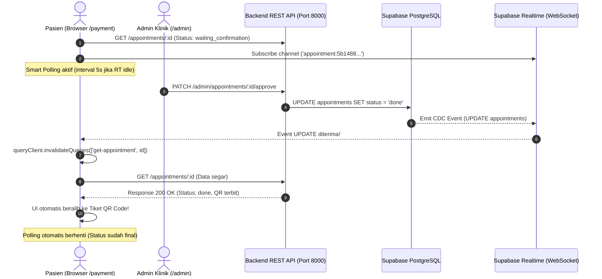

# Plan [009] - Fitur Auto-Reload / Realtime Sync Data di Halaman /payment dan /history

**Tanggal:** 2026-11-05  
**Domain:** Pasien Experience, Realtime Sync, TanStack React Query, Supabase Realtime CDC  
**Status:** PROPOSED & READY FOR IMPLEMENTATION  

---

## 1. Latar Belakang & Kebutuhan Pengguna

Pengguna menanyakan:
> *"bisa ga tambahkan fitur auto reload saat page /payment/ dan /history/ ada perubahan data dari backend?"*

### Skenario Nyata di Lapangan:
1. **Halaman Pembayaran (`/payment/[appointmentId]`)**:
   - Pasien mengunggah bukti transfer bank. Status berubah menjadi `waiting_confirmation`.
   - Admin di dashboard admin (`/admin/payment`) memverifikasi dan menyetujui transaksi (`done`).
   - **Ekspektasi Pasien**: Layar pembayaran pasien secara otomatis berubah menampilkan **Tiket QR Code & Nomor Antrean** tanpa pasien harus menekan tombol refresh atau me-reload halaman browser (F5).
   - Begitu pasien tiba di klinik dan resepsionis men-scan barcode (`check-in`), layar otomatis memperbarui status menjadi `Terverifikasi Hadir` beserta Nomor Antrean Fisik.
2. **Halaman Riwayat (`/history`)**:
   - Pasien sedang melihat daftar reservasi.
   - Jika ada reservasi yang baru disetujui, ditolak, atau kedaluwarsa oleh sistem, status kartu reservasi langsung ter-update secara otomatis.

---

## 2. Analisis Opsi Arsitektur

Karena frontend kita menggunakan **TanStack React Query v5** dan terhubung ke **Backend REST API Express Gateway** serta **PostgreSQL Supabase**, ada 3 strategi yang dapat diterapkan:

| Parameter | Opsi A: Smart Conditional Polling (React Query) | Opsi B: Supabase Realtime (WebSocket Push) | Opsi C: Hybrid (Realtime + Smart Fallback) ⭐ *Rekomendasi* |
| :--- | :--- | :--- | :--- |
| **Kecepatan Update** | 3–5 detik | Instan (< 1 detik) | Instan (< 1 detik) dengan fallback 5 detik |
| **Beban Server / DB** | Sangat Rendah (hanya polling saat status transitif) | Sangat Rendah (koneksi WebSocket persisten) | Sangat Rendah & Paling Aman |
| **Ketergantungan SQL** | **Nol (Tidak perlu ubah database)** | Butuh `alter publication supabase_realtime add table appointments;` | Butuh 1 baris SQL untuk Realtime |
| **Kesesuaian Arsitektur** | 100% Pure REST API | Pure REST API (Websocket hanya sinyal trigger) | 100% Sesuai Aturan AGENT.md & TECH.md |
| **Ketahanan Jaringan** | Sangat tahan (bekerja di jaringan seluler apa pun) | Rentan jika WebSocket terputus / firewall ketat | **Maksimal** (tetap jalan meski websocket putus) |

---

## 3. Desain Solusi Rekomendasi (Opsi C: Hybrid)

### Prinsip Kerja Arsitektur:
1. **Event Trigger (Sinyal)**:
   - Browser mendengarkan perubahan status dari Supabase Realtime channel `appointments`.
   - ATAU Smart Polling berkala (setiap 4–5 detik) yang **hanya aktif** ketika status janji temu masih memerlukan update (`waiting_payment` atau `waiting_confirmation`).
2. **Data Fetching (Payload)**:
   - Sesuai aturan **Frontend Pure REST API Rule**, frontend **DILARANG** membaca langsung data mentah Supabase.
   - Begitu sinyal perubahan terdeteksi, frontend memanggil `queryClient.invalidateQueries(...)` yang otomatis mengeksekusi endpoint REST API resmi backend (`GET /api/v1/appointments/:id` atau `GET /api/v1/appointments/me`).
3. **Pemberhentian Polling Otomatis**:
   - Begitu status janji temu sudah final (`done`, `expired`, `rejected`, atau `canceled`), polling otomatis dinonaktifkan (`refetchInterval: false`), sehingga hemat baterai, kuota, dan CPU.



---

## 4. Rincian Langkah Pengerjaan

### Langkah 1: Aktifkan Smart Polling & Auto-Refetch di TanStack Query Hooks
- **Lokasi File**: `src/hooks/api/use-appointments.ts`
- **Tindakan**:
  - Pada `useGetAppointment(id)`:
    - Tambahkan opsi `refetchInterval`: fungsi dinamis `(query) => { const status = query.state.data?.data?.status; return ['waiting_payment', 'waiting_confirmation'].includes(status) ? 4000 : false; }`.
    - Tambahkan opsi `refetchOnWindowFocus: true` (begitu pasien kembali dari aplikasi perbankan/m-banking ke tab browser, status langsung diperbarui seketika).
  - Pada `useGetMyAppointments({ page, limit })`:
    - Tambahkan opsi `refetchInterval`: fungsi dinamis yang mengecek apakah ada janji temu yang berstatus `waiting_payment` atau `waiting_confirmation` dalam daftar. Jika ada, poll setiap 8000ms (8 detik). Jika tidak ada, `false`.

### Langkah 2: Tambahkan Hook Realtime Listener (Supabase Event Bus)
- **Lokasi File**: `src/hooks/use-appointment-realtime.ts` (File Baru)
- **Tindakan**:
  - Menerima `appointmentId` (opsional untuk spesifik reservasi) dan `patientId`.
  - Berlangganan ke channel `supabase.channel(...)` mendengarkan event `postgres_changes` untuk tabel `appointments`.
  - Saat ada mutasi `UPDATE`, panggil:
    ```typescript
    queryClient.invalidateQueries({ queryKey: ['get-appointment', appointmentId] });
    queryClient.invalidateQueries({ queryKey: ['get-my-appointments'] });
    ```

### Langkah 3: Integrasikan ke Komponen Halaman
1. **Di `src/components/user/booking/payment-upload.tsx`**:
   - Panggil `useAppointmentRealtime(appointmentId)` agar layar `/payment/:id` menerima sinyal update seketika saat admin approve/reject atau saat resepsionis check-in.
2. **Di `src/app/(user)/(panel)/history/page.tsx`** atau komponen riwayat:
   - Panggil hook realtime untuk mendengarkan perubahan daftar janji temu pasien.

### Langkah 4: Publikasi Supabase Realtime di Database (Opsional untuk Push Instan)
- Jika ingin event WebSocket instan aktif, tambahkan tabel `appointments` ke publikasi `supabase_realtime` di database Supabase:
  ```sql
  alter publication supabase_realtime add table public.appointments;
  ```
  *(Catatan: Jika langkah SQL ini belum dijalankan, Smart Polling di Langkah 1 sudah 100% mencukupi dan bekerja secara mulus setiap 4 detik tanpa jeda).*

---

## 5. Rencana Pengujian & Verifikasi
1. **Uji Transisi Pembayaran ke Konfirmasi**:
   - Pasien upload bukti transfer -> halaman otomatis polling dan menangkap perubahan saat admin menyetujui.
2. **Uji Admin Approval**:
   - Buka 2 tab browser berdampingan: Tab 1 halaman `/payment/:id` pasien, Tab 2 halaman `/admin/payment` admin.
   - Admin klik tombol "Setujui Pembayaran".
   - Verifikasi bahwa Tab 1 pasien berubah otomatis memunculkan Tiket QR Code tanpa refresh manual.
3. **Uji Scan Check-in Resepsionis**:
   - Admin memproses check-in pasien.
   - Verifikasi bahwa layar tiket QR pasien otomatis berubah menampilkan status `Terverifikasi Hadir` dan nomor antrean fisik.
4. **Verifikasi Beban Jaringan**:
   - Pastikan request polling berhenti total saat status sudah `done` atau `canceled`.

